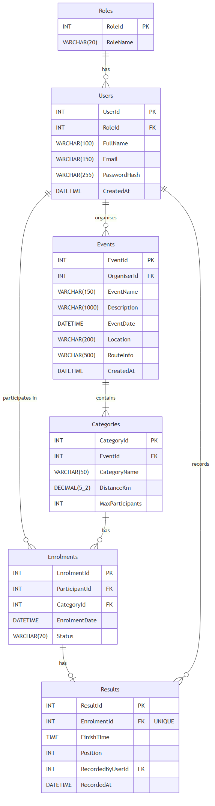

# RaceDay – PROG6212 Portfolio of Evidence (Part 1)

## What is RaceDay?

RaceDay is a web-based event management platform built for the South African road running, walking, and cycling community. The idea is pretty straightforward — right now a lot of events are still managed through spreadsheets and WhatsApp groups, which is a mess for both organisers and participants. RaceDay fixes that by giving organisers a proper system to create events and capture results, while participants can browse events, sign up, and track how they're doing over time.

This repo covers **Part 1** of the POE, which focuses on system planning and the database design. No API code yet — that comes in Part 2.

---

## The Two Roles

The system is built around two types of users:

- **Organiser** — someone who runs events. They can create and manage events, add race categories (like a 5km or 10km option), view who's signed up, and capture finish times and positions after the race.

- **Participant** — someone who enters events. They can browse what's on, enrol in a category, cancel their entry, and check their own results and history.

Role-based access will be enforced at the API level in Part 2.

---

## Entity Relationship Diagram

The database has 6 tables: `Roles`, `Users`, `Events`, `Categories`, `Enrolments`, and `Results`. Users play different roles depending on context — the same `Users` table covers both Organisers and Participants, distinguished by a `RoleId` foreign key. The `Enrolments` table acts as a junction between `Users` (as Participants) and `Categories`, and `Results` is linked one-to-one with `Enrolments` since each race entry can only have one captured result.

---

## Setting Up the Database

To get the database running locally:

1. Open **SQL Server Management Studio (SSMS)** and connect to your local SQL Server instance.
2. Open the file `docs/database_schema.sql`.
3. Run the entire script — it will:
   - Create a new database called `RaceDayDB` (only if it doesn't already exist)
   - Drop and recreate all 6 tables cleanly so you can re-run it without errors
   - Insert seed data: 2 Organisers, 2 Participants, 3 Events, 5 Categories, 4 Enrolments, and 2 Results
4. You can uncomment the `SELECT` statements at the bottom to verify the data loaded correctly.

> **Note:** The script targets SQL Server. It won't work as-is on MySQL or PostgreSQL.

---

## Docs Folder

All planning documents are in the `/docs` folder:

| File | Description |
|---|---|
| `ERD.png` | Entity Relationship Diagram showing all 6 tables |
| `API_Endpoint_Plan.md` | Full list of 20 planned API endpoints across all functional areas |
| `database_schema.sql` | SQL Server script with schema + seed data |

---

## CI/CD

There's a GitHub Actions workflow at `.github/workflows/validate-docs.yml` that automatically checks the repo structure on every push. It confirms that the `/docs` folder exists and contains all three required files.

**Latest build:**

---

## Presentation Video

---

## AI Disclosure

GitHub Copilot was used for autocompletion assistance while writing the SQL script and markdown files. All design decisions — including the ERD structure, table relationships, endpoint planning, and seed data — were made by me. The AI suggestions were reviewed, adjusted, and accepted or rejected based on my own understanding of the system requirements.
