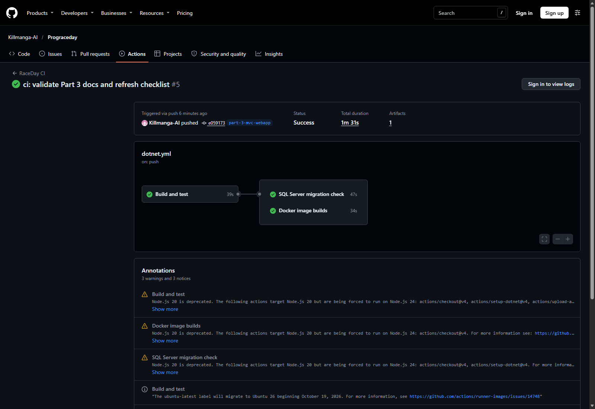
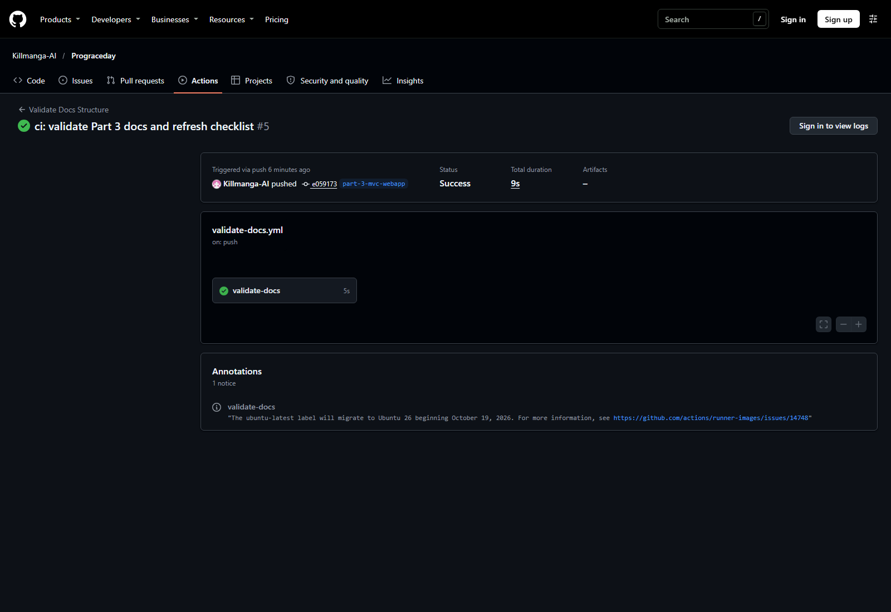

# Test results

Measured on 2026-11-09 on Windows with .NET SDK 10.0.401 targeting `net8.0` (runtime 8.0.32).

## GitHub Actions

The pushed Part 3 branch run for commit `e059173c90724421c46b16c47323b6423d978c7d` completed successfully:

- [RaceDay CI run 5](https://github.com/Killmanga-AI/Prograceday/actions/runs/42699925824): build and tests, SQL Server migration/schema check, and API/MVC Docker image builds all passed.
- [Validate Docs Structure run 5](https://github.com/Killmanga-AI/Prograceday/actions/runs/42699925809): required repository documentation checks passed.

Screenshots captured from the public GitHub Actions run pages:





## Build

```text
dotnet build RaceDay.sln --configuration Release
Build succeeded.
0 warnings
0 errors
```

Projects built: `RaceDay.Api`, `RaceDay.Mvc`, `RaceDay.Tests`, `RaceDay.Mvc.Tests`.

## API tests

```text
dotnet test RaceDay.Tests/RaceDay.Tests.csproj --configuration Release
Passed! - Failed: 0, Passed: 29, Skipped: 0, Total: 29
```

Coverage includes authentication and validation, JWT roles, public browse endpoints, organiser ownership scoping, enrolment capacity, result recording, participant results, upload type/size checks, Swagger operation coverage, health endpoint and local media storage.

## MVC tests

```text
dotnet test RaceDay.Mvc.Tests/RaceDay.Mvc.Tests.csproj --configuration Release
Passed! - Failed: 0, Passed: 40, Skipped: 0, Total: 40
```

The MVC suite hosts the real application with `WebApplicationFactory` and a Kestrel stub API on a random loopback port. It exercises:

- anonymous/login/register/logout and session expiry;
- participant vs organiser authorisation, including direct URL attempts;
- antiforgery rejection on POSTs;
- upload validation before the API call and successful multipart uploads;
- event CRUD, categories, enrolments and results;
- profile updates;
- 404/500 status pages and `no-store` headers on authenticated pages.

## Docker Compose smoke test

```text
docker compose up -d --build
```

Built `raceday-api:local` (386 MB) and `raceday-mvc:local` (332 MB), then started the three services. `docker compose ps` reported:

```text
raceday-api | Up (healthy)
raceday-mvc | Up (healthy)
sqlserver   | Up (healthy)
```

| Check | Result |
|---|---|
| `GET http://localhost:8081/health` | `200` — `{"status":"ok","database":"connected","storage":"Local"}` |
| Swagger JSON | `200` |
| `GET http://localhost:8080/` | `200` — title `Home · RaceDay` |
| `GET /Account/Login` | `200` |
| Anonymous `GET /Organiser/Dashboard` | `302` to login |
| Unknown path | `404` with the friendly status page |
| API register → login → create event | Token issued; event created with `201` and returned by `GET /api/events` |
| MVC form login (cookie + antiforgery) | `302` to `/Organiser/Dashboard`; dashboard `200` and shows the organiser name |

SQL Server 2022 was migrated automatically by the API container (`Database:AutoMigrate=true`) and the health check reported the database connected.

## Not covered by these runs

| Area | Status |
|---|---|
| Azure Blob Storage | Not exercised without a storage account; the local provider was used in tests and containers |
| Browser/visual review | Pages are covered by HTML assertions and container smoke checks; no screenshot review recorded |

Do not present the unchecked rows as passes.
